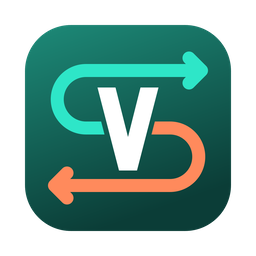

<h1 align="center">
  <br>
  Verso Translate
</h1>

<p align="center">
  
  
  
  
</p>

<p align="center">
  <strong>A small translator for selected or typed text, on macOS and Windows.</strong><br>
  Select, press a shortcut, read. No account. No telemetry.
</p>

---

## 📥 Download & Install

### 🍺 Homebrew (macOS)

```bash
brew install --cask lbngoc/verso/verso
```

> **Updates:** Verso updates itself once you agree to the daily check, so `brew upgrade` is not needed
> (the cask is marked `auto_updates`).

### 📦 Manual download

|    System    |  Status  |                                          Download                                          | Guide                         |
| :----------: | :------: | :----------------------------------------------------------------------------------------: | :---------------------------- |
| **macOS** (Apple Silicon) | ✅ Ready | [📥 Verso_aarch64.dmg](https://github.com/lbngoc/verso-translate/releases/latest/download/Verso_aarch64.dmg) | [Install guide](INSTALL.md#macos) |
| **macOS** (Intel) | ✅ Ready | [📥 Verso_x64.dmg](https://github.com/lbngoc/verso-translate/releases/latest/download/Verso_x64.dmg) | [Install guide](INSTALL.md#macos) |
| **Windows** (64-bit) | ✅ Ready | [📥 Verso_x64-setup.exe](https://github.com/lbngoc/verso-translate/releases/latest/download/Verso_x64-setup.exe) | [Install guide](INSTALL.md#windows) |

Every release also publishes [`SHA256SUMS.txt`](https://github.com/lbngoc/verso-translate/releases/latest/download/SHA256SUMS.txt); the verification commands are in
[INSTALL.md](INSTALL.md).

<details>
<summary><strong>⚠️ macOS: the app does not open?</strong></summary>

The build is ad-hoc signed but not notarized, so macOS blocks it once with "Apple could not verify 'Verso'
is free of malware".

1. Dismiss the alert with **Done** (not **Move to Trash**).
2. Open **System Settings › Privacy & Security**, scroll to **Security** and click **Open Anyway** next to
   Verso, then enter your login password. The button is offered for about an hour after the blocked attempt.
3. On macOS 13 and 14 you can also right-click `Verso` in `Applications` and choose **Open**.
4. Turn on Verso in **Privacy & Security › Accessibility** so it can read the selected text.

The Terminal fallback is in [INSTALL.md](INSTALL.md).

</details>

<details>
<summary><strong>⚠️ Windows: SmartScreen blocks the installer?</strong></summary>

The Windows build is not code-signed yet. On "Windows protected your PC" choose **More info**, then
**Run anyway**. The installer needs no administrator rights.

</details>

## ✨ Features

### 🔥 Highlights

- ⌨️ **Select, press, read** — `Alt+Shift+Z` shows a small tooltip next to the selection that grows into the translation
- 🔊 **Speak** — `Alt+Shift+S` reads the selection aloud without opening a window
- 🪟 **Quick panel** — `Alt+Shift+T` (or a click on the tray mark) opens a panel for text you type; `Tab` swaps the languages
- 🔁 **Two engines, automatic fallback** — Google Translate and Microsoft Translator (Bing); no account or API key
- 🎯 **Keyboard-first popup** — it takes keys as soon as the result shows: `c` copy, `s` speak, `-` `=` `0` text size
- 🔄 **Updates itself** — signed, verified downloads, once you agree to the daily check

### 📋 Everything

- 🌐 **Automatic source language** and dozens of target languages
- 🗣️ **English or Vietnamese interface**
- 🎨 **Light and dark themes**, with the Verso teal or the system accent
- ⚙️ **Shortcut recorder** — change any shortcut in **Settings › Shortcuts**; updates never change a key you saved
- 📋 **Clipboard prefill** — opt in to paste the clipboard into the quick panel
- 🐞 **Report a problem** from the tray or Settings, with the log tail prefilled into the issue form

### 🛡️ Privacy

- 🚫 **No telemetry** — nothing is collected about you
- 🚫 **No account** — no sign-in, no API key
- 🔎 **Clear about where your text goes** — only the engine you use receives it; see [PRIVACY.md](PRIVACY.md)

---

## 📚 Documentation

- [INSTALL.md](INSTALL.md) — install on macOS and Windows, checksums, permissions, updates
- [TROUBLESHOOTING.md](TROUBLESHOOTING.md) — blocked engines, shortcuts, logs, updates, reporting
- [PRIVACY.md](PRIVACY.md) — which engine receives your text
- [TERMS.md](TERMS.md) — terms for the binaries
- [CHANGELOG.md](CHANGELOG.md) — what each release contains
- [THIRD_PARTY.md](THIRD_PARTY.md) — third-party notices
- [SECURITY.md](SECURITY.md) — reporting a problem privately

---

## 📄 License

The source is open at [github.com/lbngoc/verso](https://github.com/lbngoc/verso) under the
[MIT licence](https://github.com/lbngoc/verso/blob/main/LICENSE); issues and pull requests are welcome there.
This repository holds the published documents and the release downloads. The terms that apply to the
binaries are in [TERMS.md](TERMS.md).

Copyright © 2026 Ngoc Luong.

---

[Tiếng Việt](README_vi.md)
