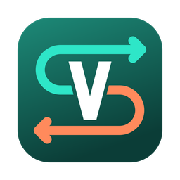
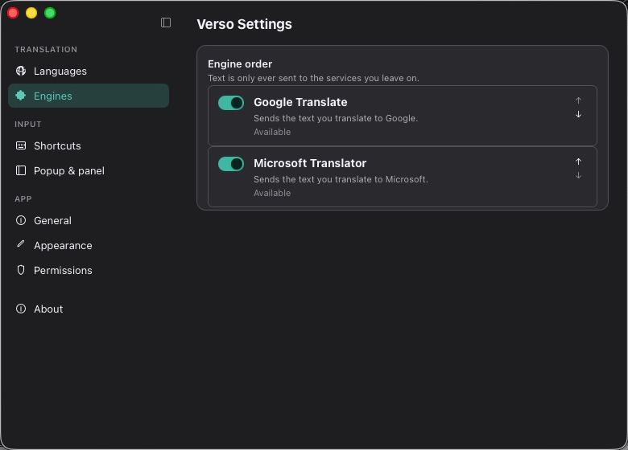

<h1 align="center">
  <br>
  Verso Translate
</h1>

<p align="center">
  <strong>Ứng dụng dịch nhỏ gọn cho văn bản đã chọn hoặc tự nhập, trên macOS và Windows.</strong><br>
  Chọn, nhấn phím tắt, đọc. Không tài khoản. Không telemetry.
</p>

<p align="center">
  <a href="https://github.com/lbngoc/verso-translate/releases/latest"></a>
  <a href="https://github.com/lbngoc/verso-translate/releases"></a>
  <a href="#-homebrew-macos"></a>
  <a href="#-winget-windows"></a>
  
  
  <a href="https://github.com/lbngoc/verso/blob/main/LICENSE"></a>
</p>

---

### (Chọn ngôn ngữ dưới đây / Choose your language below)

<a href="README_vi.md"></a>
<a href="README.md"></a>

---

<p align="center">
  
</p>

---

## 📥 Tải về & Cài đặt

### 🍺 Homebrew (macOS)

```bash
brew install --cask lbngoc/verso/verso
```

> **Cập nhật:** Verso tự cập nhật sau khi bạn đồng ý kiểm tra tự động nên không cần `brew upgrade`
> (cask đặt `auto_updates`).

### 🪟 winget (Windows)

> **Đang chờ duyệt:** gói winget đang [chờ moderator của winget-pkgs duyệt](https://github.com/microsoft/winget-pkgs/pull/484566), nên lệnh này
> chưa tìm thấy gói. Trong lúc chờ, dùng bộ cài trong mục **Tải thủ công** bên dưới.

```powershell
winget install lbngoc.Verso
```

> **Cập nhật:** Verso tự cập nhật sau khi bạn đồng ý kiểm tra tự động nên không cần `winget upgrade`.
> SmartScreen vẫn hỏi xác nhận một lần vì bộ cài chưa được ký số.

### 📦 Tải thủ công

|  Hệ điều hành  | Trạng thái |                                         Tải xuống                                          | Hướng dẫn                         |
| :------------: | :--------: | :----------------------------------------------------------------------------------------: | :-------------------------------- |
| **macOS** (Apple Silicon) | ✅ Sẵn sàng | [📥 Verso_aarch64.dmg](https://github.com/lbngoc/verso-translate/releases/latest/download/Verso_aarch64.dmg) | [Xem hướng dẫn](INSTALL.md#macos) |
| **macOS** (Intel) | ✅ Sẵn sàng | [📥 Verso_x64.dmg](https://github.com/lbngoc/verso-translate/releases/latest/download/Verso_x64.dmg) | [Xem hướng dẫn](INSTALL.md#macos) |
| **Windows** (64-bit) | ✅ Sẵn sàng | [📥 Verso_x64-setup.exe](https://github.com/lbngoc/verso-translate/releases/latest/download/Verso_x64-setup.exe) | [Xem hướng dẫn](INSTALL.md#windows) |

Mỗi bản phát hành kèm [`SHA256SUMS.txt`](https://github.com/lbngoc/verso-translate/releases/latest/download/SHA256SUMS.txt); lệnh kiểm tra nằm trong
[INSTALL.md](INSTALL.md).

<details>
<summary><strong>⚠️ macOS: app không mở được?</strong></summary>

Bản cài được ký bằng chứng chỉ riêng của Verso nhưng chưa notarize, nên macOS chặn một lần với thông báo "Apple could not verify
'Verso' is free of malware".

1. Bấm **Done** (không chọn **Move to Trash**).
2. Mở **System Settings › Privacy & Security**, cuộn xuống **Security**, bấm **Open Anyway** cạnh Verso rồi
   nhập mật khẩu. Nút chỉ hiện khoảng một giờ sau lần mở bị chặn.
3. Trên macOS 13 và 14 có thể chuột phải `Verso` trong `Applications` rồi chọn **Open**.
4. Bật Verso trong **Privacy & Security › Accessibility** để app đọc được văn bản đã chọn.

Cách dùng Terminal nằm trong [INSTALL.md](INSTALL.md).

</details>

<details>
<summary><strong>⚠️ Windows: SmartScreen chặn bộ cài?</strong></summary>

Bản Windows chưa được ký số. Ở màn hình "Windows protected your PC", chọn **More info** rồi **Run anyway**.
Bộ cài không cần quyền quản trị.

</details>

## ✨ Tính năng

### 🔥 Nổi bật

- ⌨️ **Chọn, nhấn, đọc** — `Alt+Shift+Z` hiện tooltip nhỏ cạnh vùng chọn rồi lớn dần thành bản dịch
- 🔊 **Đọc** — `Alt+Shift+S` đọc văn bản đã chọn mà không mở cửa sổ
- 🖼️ **Dịch một vùng màn hình** (tuỳ chọn) — `Alt+Shift+X` làm tối màn hình; kéo quanh chữ trong ảnh, video hay ứng dụng không chọn được chữ, chữ đọc được mở trong bảng dịch ngay cạnh để bạn sửa trước khi dịch. Mặc định tắt, bật ở **Cài đặt › Chung › Dịch màn hình**; ảnh chỉ nằm trong bộ nhớ
- 🪟 **Bảng dịch nhanh** — `Alt+Shift+T` (hoặc bấm biểu tượng khay) mở bảng cho văn bản bạn tự nhập; `Tab` đổi ngôn ngữ
- 🔁 **Hai engine, tự chuyển khi lỗi** — Google Translate và Microsoft Translator (Bing); không cần tài khoản hay API key
- 🎯 **Popup bấm phím là dùng** — nhận phím ngay khi có kết quả: `c` sao chép, `s` đọc, `-` `=` `0` cỡ chữ
- 🔄 **Tự cập nhật** — bản tải về được ký và xác minh, sau khi bạn đồng ý kiểm tra tự động

### 📋 Đầy đủ

- 🌐 **Tự nhận diện ngôn ngữ nguồn**, hàng chục ngôn ngữ đích
- 🗣️ **Giao diện tiếng Anh hoặc tiếng Việt**
- 🎨 **Chủ đề sáng/tối**, màu nhấn teal của Verso hoặc màu hệ thống
- ⚙️ **Ghi phím tắt** — đổi mọi phím trong **Cài đặt › Phím tắt**; bản cập nhật không đổi phím bạn đã lưu
- 📋 **Điền sẵn từ clipboard** — bật tuỳ chọn để dán clipboard vào bảng dịch nhanh
- 🐞 **Báo lỗi** từ khay hoặc Cài đặt, phần cuối log được điền sẵn vào form issue

### 🛡️ Quyền riêng tư

- 🚫 **Không telemetry** — không thu thập gì về bạn
- 🚫 **Không tài khoản** — không đăng nhập, không API key
- 🔎 **Rõ văn bản đi đâu** — chỉ engine bạn dùng nhận văn bản; xem [PRIVACY.md](PRIVACY.md)

---

## 📚 Tài liệu

Các tài liệu chi tiết hiện bằng tiếng Anh:

- [INSTALL.md](INSTALL.md) — cài trên macOS và Windows, checksum, quyền, cập nhật
- [TROUBLESHOOTING.md](TROUBLESHOOTING.md) — engine bị chặn, phím tắt, log, cập nhật, báo lỗi
- [PRIVACY.md](PRIVACY.md) — engine nào nhận văn bản của bạn
- [TERMS.md](TERMS.md) — điều khoản cho bản binary
- [CHANGELOG.md](CHANGELOG.md) — thay đổi từng bản
- [THIRD_PARTY.md](THIRD_PARTY.md) — thông báo bên thứ ba
- [SECURITY.md](SECURITY.md) — báo lỗi bảo mật riêng tư

---

## 📄 Giấy phép

Mã nguồn mở tại [github.com/lbngoc/verso](https://github.com/lbngoc/verso) theo
[giấy phép MIT](https://github.com/lbngoc/verso/blob/main/LICENSE).
Kho này chứa tài liệu công khai và bản tải về. Báo lỗi và góp ý tại
[issues](https://github.com/lbngoc/verso-translate/issues) của kho này (Verso › Giới thiệu › Báo lỗi… điền
sẵn biểu mẫu). Điều khoản áp dụng cho bản binary nằm ở [TERMS.md](TERMS.md).

Copyright © 2026 Ngoc Luong.

